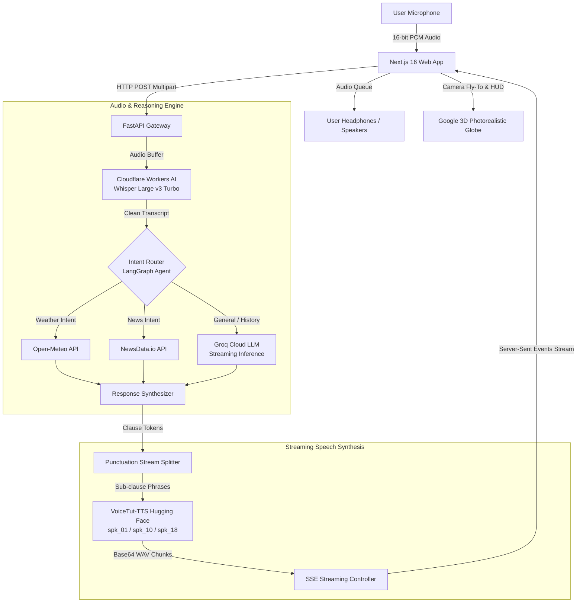

# AnaZone

> Real-time conversational Arabic voice AI paired with photorealistic 3D Earth exploration.

[](LICENSE)
[](https://python.org)
[](https://nextjs.org)
[](https://fastapi.tiangolo.com)
[](https://developers.cloudflare.com/workers-ai/)
[](https://groq.com)
[](https://huggingface.co)

---

## What is AnaZone?

AnaZone is an open-source, full-stack voice AI application that connects sub-second speech intelligence with a photorealistic 3D globe. Users can touch any coordinate on Earth or converse naturally by voice to explore live atmospheric weather, breaking local news, and geographical history in authentic Egyptian Arabic (*Masri*) and English.

Most Arabic voice systems rely on rigid Modern Standard Arabic (MSA), which sounds synthetic and unnatural for spontaneous spoken dialogue. AnaZone solves this by deploying voice models tuned for natural Egyptian phonetics and colloquial phrasing, orchestrated through a low-latency streaming pipeline.

Built on a **zero-retention architecture**, conversations are maintained strictly in the client's browser memory—no database storage, no audio file persistence, and no biometric fingerprinting.

---

## System Architecture



### Latency Budget & Pipeline Breakdown

To achieve a natural conversational flow without uncomfortable silence, AnaZone pipelines speech synthesis concurrently with token generation:

| Stage | Technology | Typical Latency | Function |
| :--- | :--- | :--- | :--- |
| **Speech-to-Text** | Cloudflare Workers AI (Whisper Large v3 Turbo) | ~150–280 ms | Edge-accelerated multilingual transcription with auto-language detection |
| **Agent Reasoning** | LangGraph + Groq Cloud (`gpt-oss-120b` / `qwen3.8-27b`) | ~120 ms TTFT | Intent classification, external tool calling, and response generation |
| **Punctuation Dispatch** | Regex Stream Tokenizer | < 5 ms | Splits token stream on terminal punctuation (`.!?؟`) and pauses (`،,؛`) |
| **Speech Synthesis** | VoiceTut-TTS on Hugging Face ZeroGPU | ~300–450 ms / chunk | Generates 24 kHz WAV chunks per clause rather than waiting for full response |
| **Client Audio Queue** | Web Audio API / HTML5 Audio | Immediate | Seamless sequential playback with real-time waveform visualization |

---

## Key Features

- **Conversational Voice AI**: Sub-second transcription via Cloudflare Whisper Turbo with energy-gated VAD to eliminate background noise hallucinations.
- **Dialectal Egyptian Voice Personas**:
  - `spk_18_female` (*Yasmin*): Composed, articulate, and clear tone.
  - `spk_01_male` (*Ahmed*): Warm, conversational, and approachable guide.
  - `spk_10_male` (*Tareq*): Dynamic, energetic, and engaging narrator.
- **Autonomous Tool-Using Agent**: LangGraph state machine dynamically calls real-time tools:
  - **Live Weather**: Open-Meteo API (temperature, wind speed, atmospheric conditions worldwide, no API key required).
  - **Breaking News**: NewsData.io integration mapped to ISO country codes with regional fallbacks.
  - **Reverse Geocoding**: Direct coordinate lookup for planetary locations.
- **Photorealistic 3D Earth Explorer**: Hardware-accelerated 3D globe with interactive coordinate HUD, quick-travel landmarks (Giza Pyramids, Tokyo, Paris, Dubai, New York, Petra), and atmospheric weather layers.
- **Zero-Retention Privacy**: Stateless by design. All session context resides solely in React component state. Closing the tab or refreshing wipes all chat history.
- **Bilingual Interface**: Seamless switching between Arabic (RTL typography with clean structural alignment) and English.

---

## Project Structure

```text
AnaZone/
├── backend/
│   ├── main.py                  # FastAPI entry point, CORS middleware, and route mounting
│   ├── config.py                # Environment loading and persona metadata definitions
│   ├── streaming.py             # Server-Sent Events (SSE) and fast clause chunking
│   ├── Dockerfile               # Production container definition
│   ├── requirements.txt         # Pinned Python dependencies
│   ├── routers/
│   │   ├── voice.py             # STT, TTS, full voice pipeline, and SSE streaming
│   │   ├── chat.py              # Text chat, suggestions, and warm spoken greetings
│   │   └── graph_viz.py         # LangGraph topology inspection route
│   └── services/
│       ├── agent_graph.py       # LangGraph state machine and tool orchestration
│       ├── stt_service.py       # Cloudflare Workers AI Whisper integration
│       ├── tts_service.py       # Hugging Face VoiceTut-TTS client
│       └── llm_service.py       # Groq Cloud streaming inference engine
│
├── frontend/
│   ├── src/
│   │   ├── app/
│   │   │   ├── layout.tsx       # Root layout, metadata, and typography
│   │   │   ├── page.tsx         # Main page assembly (Hero, Globe, Voice Agent)
│   │   │   ├── globals.css      # Design system tokens and custom keyframe animations
│   │   │   └── docs/            # Route displaying project easter egg
│   │   ├── components/
│   │   │   ├── HeroSection.tsx  # Dynamic hero banner with responsive typography
│   │   │   ├── UnifiedVoiceChat.tsx # Mic capture, wave recorder, and SSE stream consumer
│   │   │   ├── Google3DRealMap.tsx  # Photorealistic 3D globe and coordinate HUD
│   │   │   ├── Navbar.tsx       # Navigation bar and bilingual language toggle
│   │   │   └── Footer.tsx       # Minimalist footer with zero-retention privacy modal
│   │   └── lib/
│   │       ├── api.ts           # Type-safe API client with trailing-slash sanitization
│   │       ├── i18n.tsx         # Arabic/English localization context
│   │       └── wavRecorder.ts   # Hardware-synced 16-bit PCM WAV audio recorder
│   ├── package.json             # Frontend dependencies
│   └── next.config.ts           # Next.js configuration with Turbopack optimizations
│
├── .env.example                 # Environment variables template
├── Procfile                     # Process file for Render / Railway deployments
├── LICENSE                      # MIT License
└── README.md                    # Project documentation
```

---

## Quickstart (Local Development)

### 1. Prerequisites
- **Python**: 3.11 or higher
- **Node.js**: 20 LTS or higher
- **Package Manager**: `npm` (v10+) or `pnpm`

### 2. Clone Repository
```bash
git clone https://github.com/mohammedAlrobae/AnaZone.git
cd AnaZone
```

### 3. Environment Setup
Copy the example environment file and fill in your API credentials:
```bash
cp .env.example .env
```

| Key | Required | Purpose | Provider |
| :--- | :---: | :--- | :--- |
| `CLOUDFLARE_API_TOKEN` | **Yes** | Speech-to-Text inference via Workers AI | [Cloudflare Dashboard](https://dash.cloudflare.com/) |
| `CLOUDFLARE_ACCOUNT_ID` | **Yes** | Cloudflare account identifier | [Cloudflare Dashboard](https://dash.cloudflare.com/) |
| `CLOUDFLARE_WHISPER_MODEL` | No | Defaults to `@cf/openai/whisper-large-v3-turbo` | Cloudflare Workers AI |
| `cloud_groq_api` / `GROQ_API_KEY` | **Yes** | High-speed LLM reasoning and agent graph | [Groq Console](https://console.groq.com/) |
| `LLM_MODEL` | No | Primary LLM model (default: `openai/gpt-oss-120b`) | Groq Cloud |
| `LLM_FALLBACK_MODEL` | No | Fallback LLM (default: `qwen/qwen3.8-27b`) | Groq Cloud |
| `HF_TOKEN` | **Yes** | Hugging Face Access Token with read access | [Hugging Face Settings](https://huggingface.co/settings/tokens) |
| `NEWSAPIKEY` | Optional | Localized breaking news feeds | [NewsData.io](https://newsdata.io/) |
| `NEXT_PUBLIC_API_URL` | No | Backend origin (default: `http://localhost:8000`) | Frontend config |
| `NEXT_PUBLIC_GOOGLE_MAPS_API_KEY` | Optional | Google Maps Platform 3D Photorealistic Tiles | [Google Cloud Console](https://console.cloud.google.com/) |

### 4. Backend Setup
```bash
# Create and activate Python virtual environment
python -m venv .venv

# On Linux/macOS:
source .venv/bin/activate

# On Windows (PowerShell):
.venv\Scripts\Activate.ps1

# Install dependencies
pip install -r backend/requirements.txt

# Start FastAPI development server
uvicorn backend.main:app --host 0.0.0.0 --port 8000 --reload
```

Verify backend health:
```bash
curl http://localhost:8000/health
# {"status":"healthy"}
```

### 5. Frontend Setup
In a separate terminal:
```bash
cd frontend

# Install dependencies
npm install

# Start Next.js development server
npm run dev
```

Open [http://localhost:3000](http://localhost:3000) in your browser.

---

## Deployment Guide

AnaZone separates frontend static/edge serving from backend Python compute:

### Backend Deployment (Render / Railway / Fly.io)

Using **Render** as an example:
1. Create a new **Web Service** connected to your repository.
2. Select **Python 3** environment:
   - **Build Command**: `pip install -r backend/requirements.txt`
   - **Start Command**: `uvicorn backend.main:app --host 0.0.0.0 --port 10000`
3. Add backend environment variables (`CLOUDFLARE_API_TOKEN`, `CLOUDFLARE_ACCOUNT_ID`, `cloud_groq_api`, `HF_TOKEN`, `NEWSAPIKEY`).
4. Once deployed, copy your backend URL (e.g., `https://anazone-backend.onrender.com`).

*(Note: Docker is also supported out of the box using [`backend/Dockerfile`](backend/Dockerfile)).*

### Frontend Deployment (Vercel)

1. Import your GitHub repository into [Vercel](https://vercel.com).
2. Set **Root Directory** to `frontend` by clicking **Edit** next to Root Directory in project settings.
3. Add the following Environment Variables in project settings:
   - `NEXT_PUBLIC_API_URL`: Your deployed backend URL (e.g. `https://anazone-backend.onrender.com`).
   - `NEXT_PUBLIC_GOOGLE_MAPS_API_KEY`: Your Google Maps key.
4. Click **Deploy**. Vercel will build the Next.js bundle and issue your production URL.

---

## API Reference

| Method | Endpoint | Description |
| :--- | :--- | :--- |
| `GET` | `/health` | Service health check returning `{"status": "healthy"}` |
| `GET` | `/api/voice/voices` | Returns active personas, voice IDs, and audio audition samples |
| `GET` | `/api/voice/sample/{voice_id}` | Streams pre-rendered audio sample for the requested persona |
| `POST` | `/api/voice/transcribe` | Transcribes 16-bit PCM audio via Cloudflare Whisper Turbo |
| `POST` | `/api/voice/synthesize` | Direct text-to-speech synthesis using VoiceTut-TTS |
| `POST` | `/api/voice/pipeline` | Complete synchronous pipeline (STT ➔ LangGraph ➔ TTS) |
| `POST` | `/api/voice/pipeline/stream` | **Primary SSE Endpoint**: streams transcription, text tokens, and audio chunks |
| `POST` | `/api/chat` | Text-only conversational interaction |
| `POST` | `/api/chat/greeting` | Generates initial spoken audio greeting on session start |
| `GET` | `/api/graph/state` | Returns the LangGraph execution graph and node topology |

---

## Frequently Asked Questions & Troubleshooting

<details>
<summary><strong>Why is there a short delay on the very first voice response?</strong></summary>

VoiceTut-TTS is hosted on Hugging Face ZeroGPU. If the space is cold, spinning up the GPU worker can take a few seconds on the very first generation. Subsequent requests execute with typical latencies of ~300–450 ms per chunk.
</details>

<details>
<summary><strong>Why does the microphone require HTTPS in production?</strong></summary>

Modern web browsers restrict access to the Web Audio API and `navigator.mediaDevices.getUserMedia()` to secure contexts (`https://` or `localhost`). In production on Vercel, SSL certificates are provisioned automatically.
</details>

<details>
<summary><strong>Can I use OpenAI Whisper instead of Cloudflare Workers AI?</strong></summary>

Yes. The STT layer in [`backend/services/stt_service.py`](backend/services/stt_service.py) is modular. Cloudflare Workers AI was chosen for its edge proximity, zero infrastructure overhead, and low latency on `whisper-large-v3-turbo`.
</details>

<details>
<summary><strong>What happens if the Google Maps 3D key is missing or invalid?</strong></summary>

The 3D map component includes an interactive fallback with celestial space background and coordinates telemetry, allowing all voice and AI interactions to function normally even without 3D photorealistic tiles loaded.
</details>

---

## Contributing

Contributions, bug reports, and suggestions are welcome.
1. Fork the repository.
2. Create your feature branch (`git checkout -b feature/audio-optimization`).
3. Commit your changes (`git commit -m 'feat: enhance audio chunk buffering'`).
4. Push to the branch (`git push origin feature/audio-optimization`).
5. Open a Pull Request.

---

## License

Distributed under the [MIT License](LICENSE).
